<div align="center">


# الفجر · Fajr

**يومك يبدأ من هنا** — prayer times computed on your device, an adhan that arrives on time,
the whole Mushaf, azkar, and a daily wird. No ads, no account, and it works offline.

[**Website & downloads**](https://if12is.github.io/islamic-app/) ·
[Android APK](https://github.com/if12is/islamic-app/releases/download/apk-latest/Fajr-latest-arm64-v8a.apk) ·
[iPhone IPA](https://github.com/if12is/islamic-app/releases/download/apk-latest/Fajr.ipa) ·
[All releases](https://github.com/if12is/islamic-app/releases)


</div>

<p align="center">
  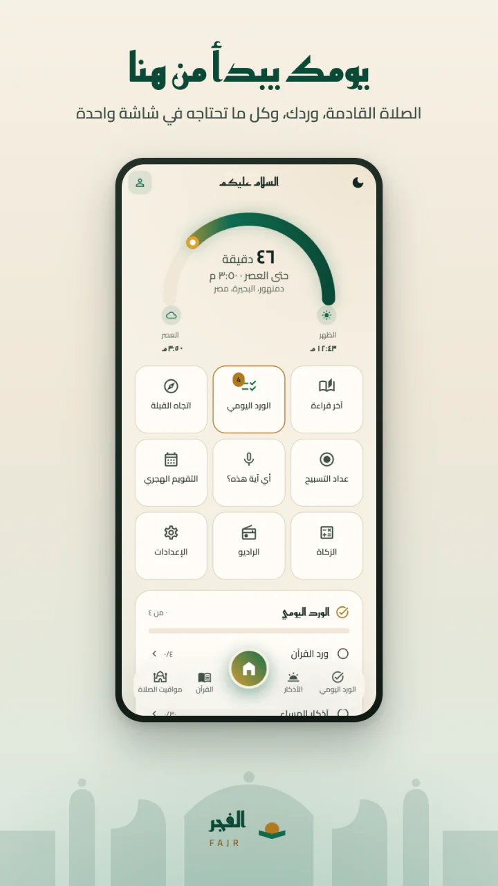
  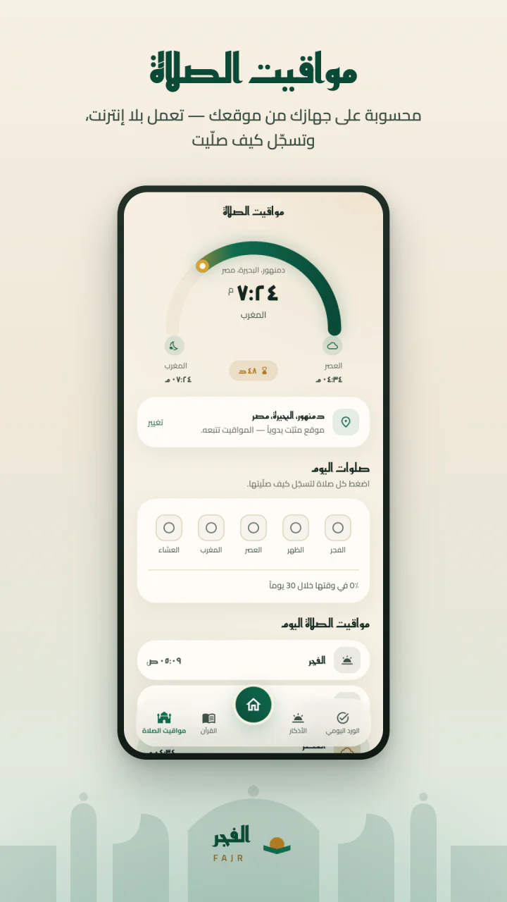
  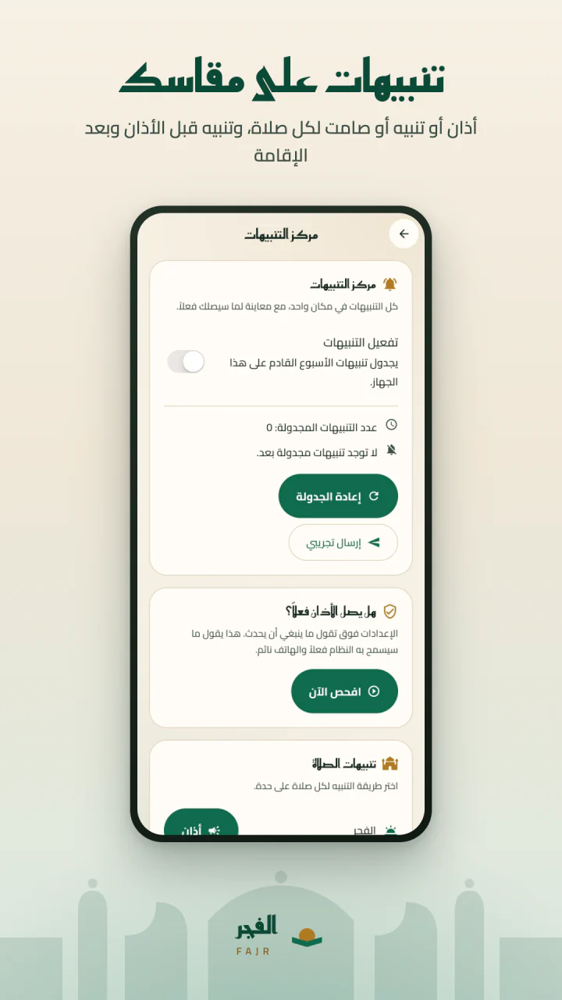
  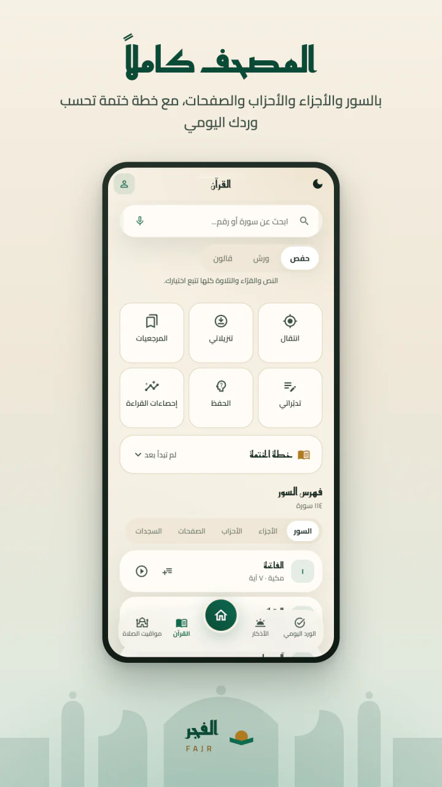
</p>

---

## Download

| Platform | File | Notes |
|---|---|---|
| **Android** (most phones) | [Fajr-latest-arm64-v8a.apk](https://github.com/if12is/islamic-app/releases/download/apk-latest/Fajr-latest-arm64-v8a.apk) | 64-bit. The right choice for almost any phone from the last eight years. |
| Android (older, 32-bit) | [Fajr-latest-armeabi-v7a.apk](https://github.com/if12is/islamic-app/releases/download/apk-latest/Fajr-latest-armeabi-v7a.apk) | Use this only if the first one will not install. |
| **iPhone** | [Fajr.ipa](https://github.com/if12is/islamic-app/releases/download/apk-latest/Fajr.ipa) | Unsigned. Install with Sideloadly, AltStore or TrollStore; not on the App Store yet. |

The links always point at the newest build. Android updates are offered from inside the app.
Installation steps for both platforms are on the [website](https://if12is.github.io/islamic-app/#download).

## Features

### Prayer times
- Computed on the device by astronomical calculation (`adhan`), for any day ahead, with no connection.
- Eight calculation methods, Hanafi Asr, high-latitude rules, and per-prayer adjustment to the minute.
- Log each prayer as you prayed it: in the mosque, in congregation, alone, or made up.
- A printable monthly timetable, a Ramadan imsakiya for your own city, the qibla compass, nearby mosques, and travel mode.
- A home-screen widget with the next prayer, a countdown, and the Hijri date.

### An adhan that arrives on time
- **Six weeks of alerts written to the device.** A native alarm engine holds the plan, so alerts keep coming even if the app is not opened for days.
- **A full day of alarm-clock alarms** armed at a time, the kind Android treats most strictly. One that fires re-arms the next day, so a dropped alarm does not end the chain.
- Re-armed by itself after a reboot, an app update, a clock or time-zone change, or travel.
- **Next prayer in the status bar** (opt-in): a live countdown that also keeps vendor battery managers from force-stopping the app.
- Adhan, notification, vibrate or silent per prayer, a separate Fajr adhan, pre-adhan and iqama alerts, quiet hours.
- **"Is the adhan actually arriving?"**: a delivery check that reports what arrived and what was missed, names the blocking setting, gives step-by-step fixes per phone brand (Honor, Huawei, Xiaomi, Samsung, Oppo, Vivo and more), and copies an alerts log to send.

### Adhan library
- 27 voices from the Haramain, Egypt, al-Aqsa, the Levant, the Gulf, the Maghreb, Turkey, Asia and Africa: old and rare recordings beside modern ones.
- Preview before choosing; each voice is downloaded only when picked.

### The Mushaf
- All 114 surahs in the Uthmani script, bundled with the app.
- Index by surah, juz, hizb or page; tajweed colouring across twelve rules.
- Tafsir on every verse, bookmarks with notes, sharing as an image, and export as video.
- Verse-by-verse recitation with synchronised highlighting, background playback, range repetition and a sleep timer.
- A khatmah plan that works out the daily portion, and spaced-repetition hifz with a finish-the-verse quiz.
- **"Which ayah is this?"**: recite a verse and the app finds it, with speech recognition running on the device.

### Azkar and the daily wird
- The complete Hisn al-Muslim: 136 chapters with their virtues and references.
- Morning and evening azkar anchored to the sun, not to a fixed hour.
- A tasbih counter that keeps its count, ruqyah, the 99 names, and salawat.
- A daily wird with pages, azkar and tasbih; add any surah, juz or chapter in one tap, with a streak and a year heat map.

### Haramain and broadcasts
- **This week's imams of the Haramain**: who leads each prayer in Makkah and Madinah, refreshed weekly from two sources.
- A shelf of rare recitations by the imams of the Haramain.
- Quran radio from Cairo and dozens of stations, plus the Quran and Sunnah channels live.

### And more
- A Hijri calendar with the white days, Mondays and Thursdays, and the Eids marked.
- A zakat calculator on the gold or silver nisab.
- Arabic (RTL) and English, a full dark theme, and backup to a file.

**Privacy:** no ads, no tracking, no account. Nothing leaves the device unless you ask it to.

## Gallery

<p align="center">
  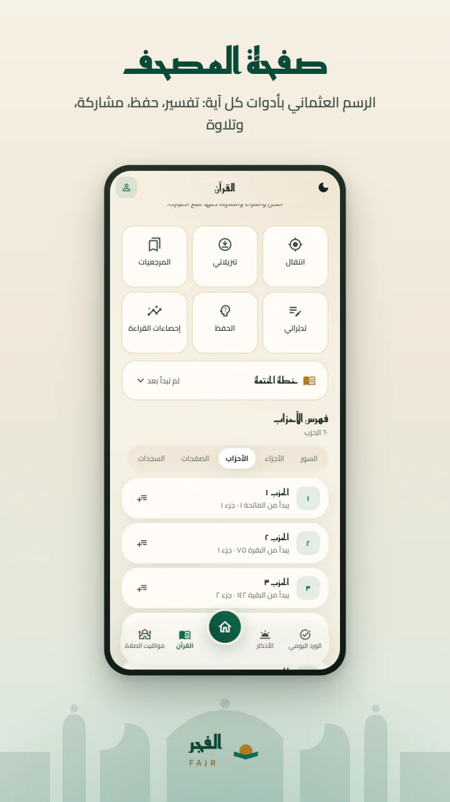
  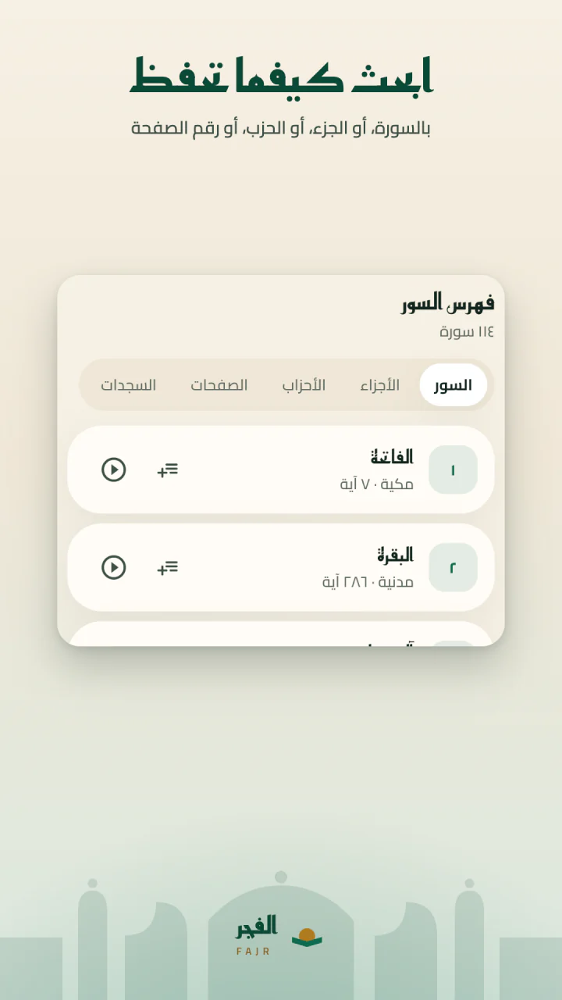
  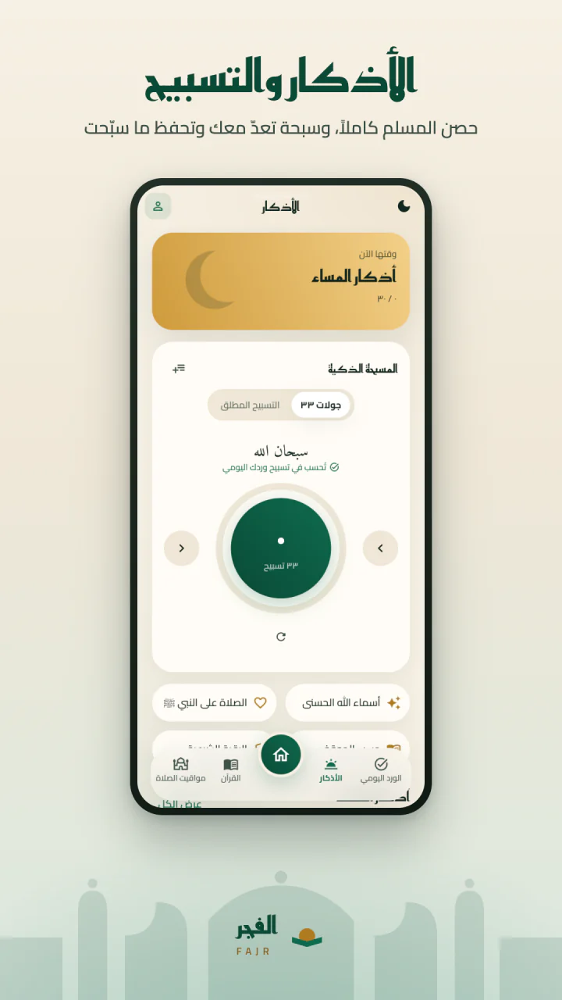
  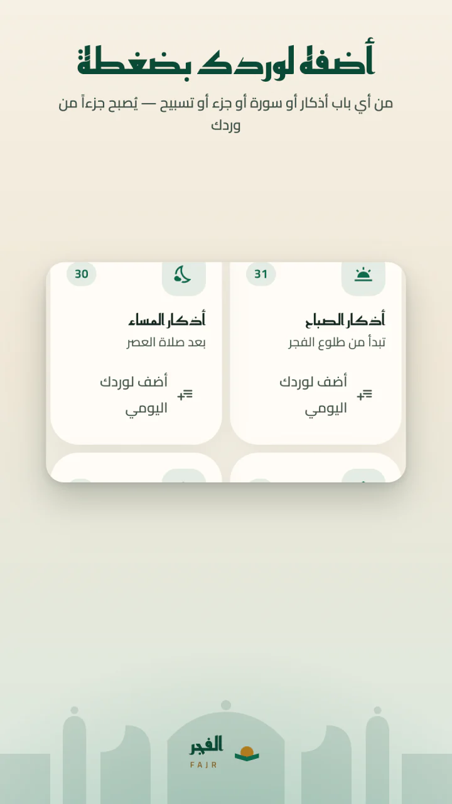
</p>
<p align="center">
  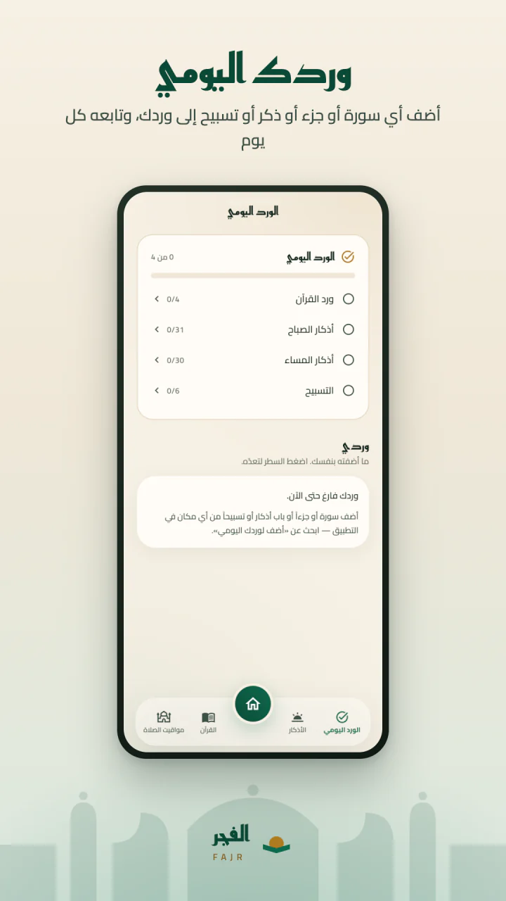
  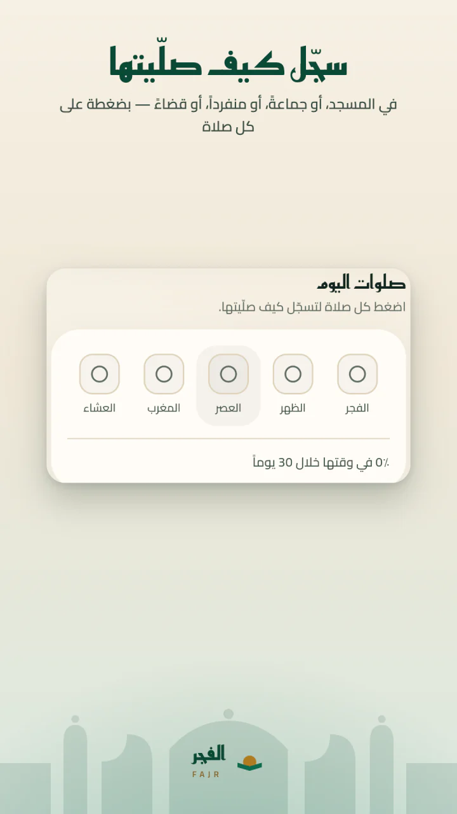
  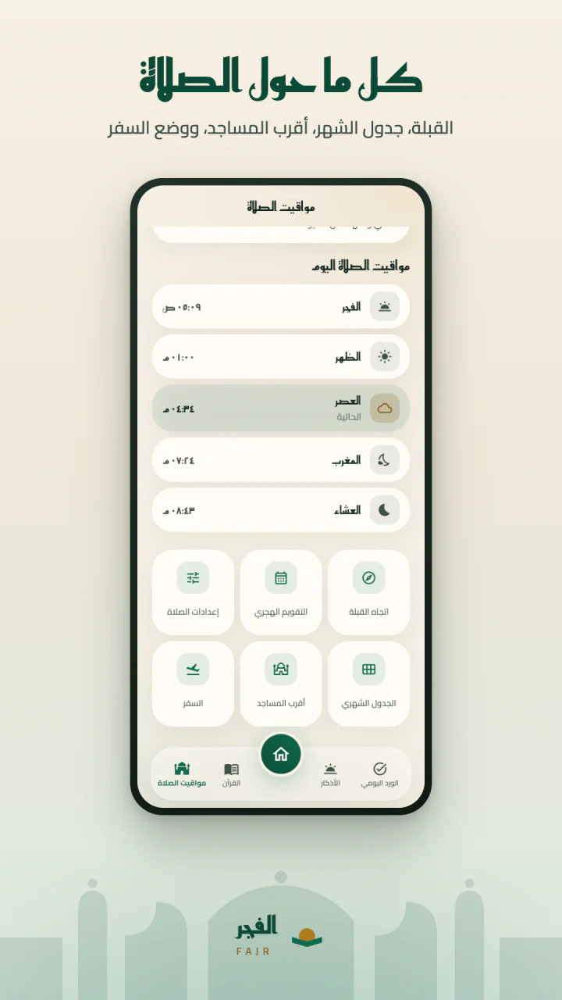
  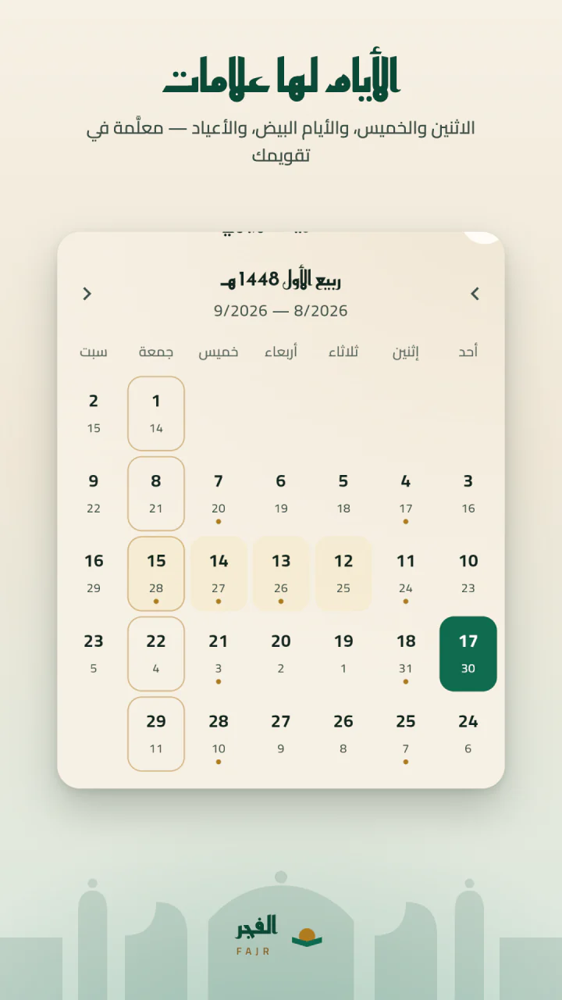
</p>
<p align="center">
  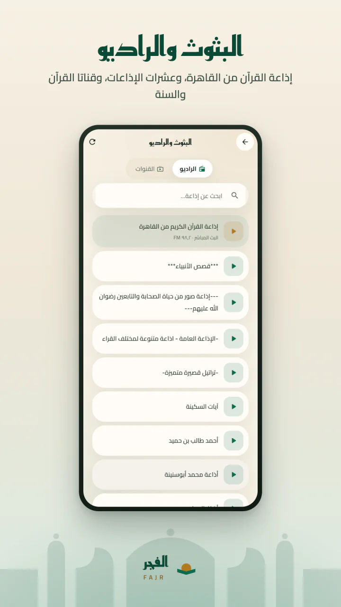
  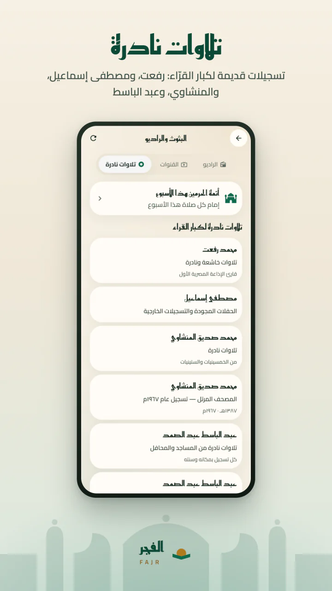
  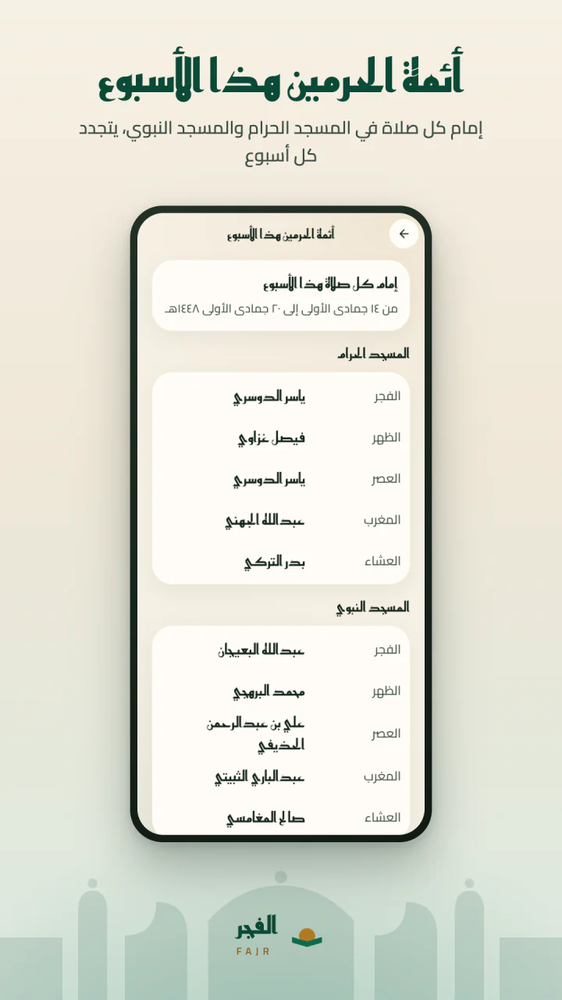
  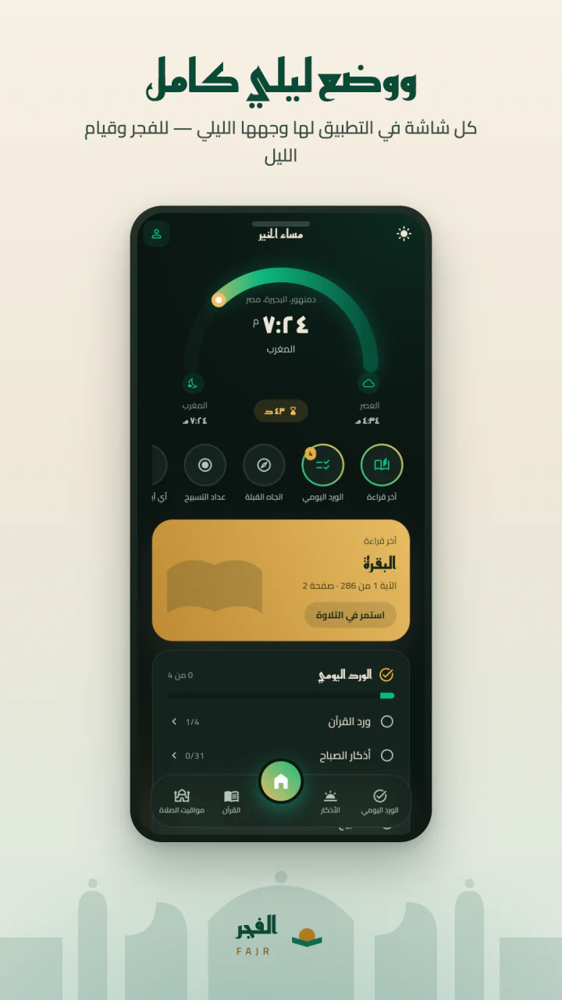
</p>

The full gallery, with every screen, is on the [website](https://if12is.github.io/islamic-app/#gallery).
All images are real captures of the app (see [`ads/README.md`](ads/README.md) for how they are made).

## Architecture

Feature-first Clean Architecture with Riverpod:

```
lib/
├── core/            # services, theme, localization, shared widgets
│   └── services/    # prayer calculation, notification planner, alarm bridge, secure HTTP
├── features/
│   ├── home/         prayer_times/   quran/      azkar/
│   ├── broadcasts/   haramain/       settings/   onboarding/
│   └── <feature>/{domain,data,presentation}
└── shared/          # app-wide providers and widgets

android/app/src/main/kotlin/.../alarms/
├── AlarmEngine.kt        # arms a day of alarm-clock alarms, records delivery
├── PrayerPlan.kt         # the six-week plan on disk, history and event log
├── PrayerAlarmReceiver.kt# shows each alert, re-arms; reboot/update/clock recovery
├── NextPrayerService.kt  # the opt-in status-bar countdown (foreground service)
└── AlarmChannel.kt       # the method channel Dart talks to
```

- Domain is pure Dart; data sources return `Either<Failure, T>`.
- All HTTP goes through `SecureHttpClient` (host allowlist); logging through `AppLogger`; strings through `context.tr`.
- Prayer times and the Mushaf are local, so the core of the app never needs the network.

More detail: [ARCHITECTURE.md](ARCHITECTURE.md) · [DEVELOPMENT.md](DEVELOPMENT.md) · [AGENTS.md](AGENTS.md).

## Tech stack

Flutter (latest stable) · Riverpod · Material 3 · `adhan` · `hijri` · `quran` · Dio · Hive · SharedPreferences ·
just_audio (+ background) · flutter_local_notifications with a native Kotlin alarm engine · home_widget ·
geolocator · flutter_compass · sherpa_onnx (on-device speech) · ffmpeg_kit (verse video export) · ota_update.

Fonts: Cairo (interface), Reem Kufi (display), Amiri Quran and Scheherazade New (Quran text).

## Build and run

```bash
git clone https://github.com/if12is/islamic-app.git
cd islamic-app
flutter pub get
flutter run
```

```bash
flutter analyze   # static analysis
flutter test      # the full suite (970+ tests)
```

### Releases (GitHub Actions)

Every push to `master` builds the Android APKs and the iOS IPA and **replaces** the rolling
[`apk-latest`](https://github.com/if12is/islamic-app/releases/tag/apk-latest) release.

| Trigger | `apk-latest` | Versioned release |
|---|---|---|
| `git push origin master` | replaced | no |
| commit message contains `[release]` | replaced | yes |
| `./scripts/release.sh 1.6.5+41` or tag `v1.6.5` | replaced | yes |
| commit message contains `[skip apk]` | skipped | skipped |

Before a user-visible push, update [`whats_new.json`](whats_new.json): the short Arabic and English lines the in-app update dialog shows.
Workflow: [`.github/workflows/android-apk.yml`](.github/workflows/android-apk.yml).

### Website

The site lives in [`docs/`](docs/) and is served by GitHub Pages at
**https://if12is.github.io/islamic-app/**. It reads the latest version and file sizes from the
GitHub Releases API, so it never needs editing for a new build.

## Contact

- 📧 Email: [ahmed.elsayed.dev1@gmail.com](mailto:ahmed.elsayed.dev1@gmail.com)
- 🐛 Issues: [GitHub Issues](https://github.com/if12is/islamic-app/issues)
- 🌐 Website: [if12is.github.io/islamic-app](https://if12is.github.io/islamic-app/)

If the adhan does not arrive on your phone, open **Settings → Notification centre → "Copy the alerts log"** and attach it to your message.

---

<div align="center"><b>Made with care for the Muslim community</b> · Version 1.6.4</div>
